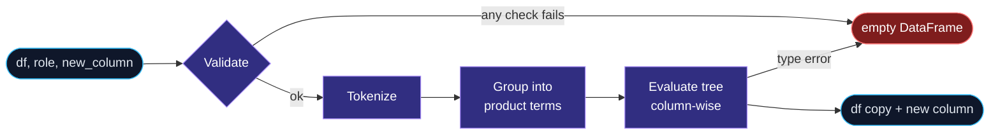
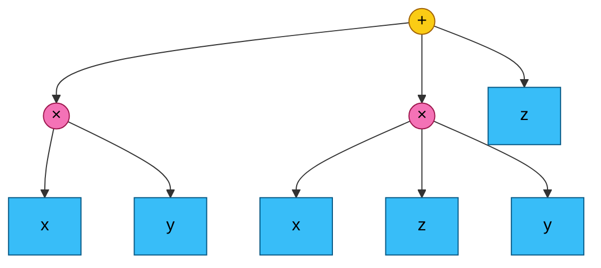
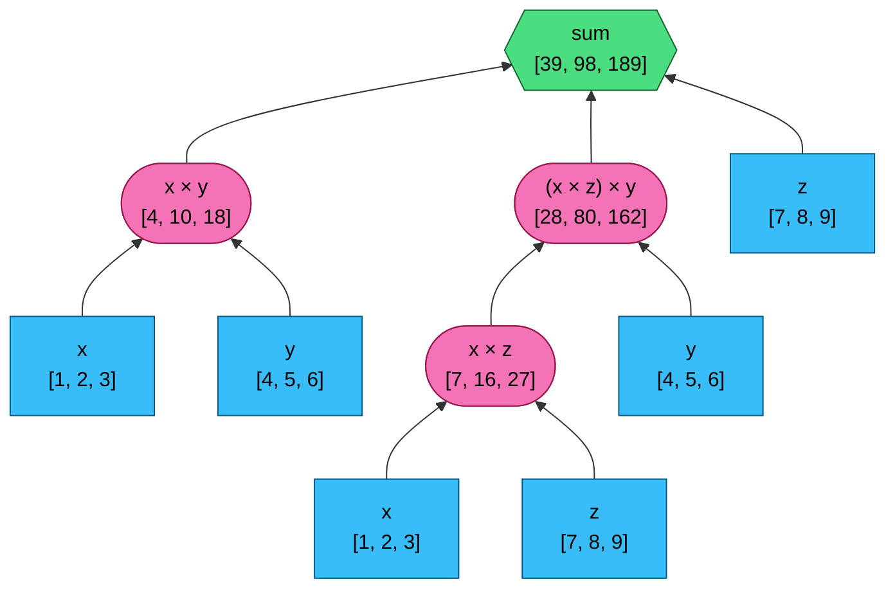

<p align="center">
  
</p>

<p align="center">
  
  
  
  
</p>

# Virtual columns in pandas

`add_virtual_column(df, role, new_column)` returns a copy of `df` with an extra column computed from an arithmetic **role** such as `quantity * price`. It supports `+`, `-` and `*` with the usual precedence. The role is parsed and evaluated by a small hand-written engine. It doesn't use `eval()` or `DataFrame.eval()`.

```python
import pandas as pd
from virtual_columns import add_virtual_column

df = pd.DataFrame({"x": [1, 2, 3], "y": [4, 5, 6], "z": [7, 8, 9]})
add_virtual_column(df, "x * y + x * z * y + z", "result")
```

```text
   x  y  z  result
0  1  4  7      39
1  2  5  8      98
2  3  6  9     189
```

## Pipeline



## Worked example: `x * y + x * z * y + z`

### 1. Tokenize

The role must match `label (op label)*`, where a label is `[A-Za-z_]+` and an operator is `+`, `-` or `*`. Whitespace is ignored.

```text
x  *  y  +  x  *  z  *  y  +  z
└──┬──┘     └─────┬─────┘     │
 term 1        term 2       term 3
```

### 2. Group into terms

`*` binds tighter than `+` and `-`, so `+`/`-` split the role into **terms** and `*` joins labels within a term. That gives a two-level expression tree: a signed sum of products.



| sign | term | labels |
|:---:|---|---|
| + | `x * y` | `x`, `y` |
| + | `x * z * y` | `x`, `z`, `y` |
| + | `z` | `z` |

### 3. Evaluate bottom-up

Each node works on whole columns at once (vectorised pandas operations). The tree below shows each node's value for all three rows `[row0, row1, row2]`:



Terms are added left to right into a running total:

| step | operation | row 0 | row 1 | row 2 |
|:---:|---|---:|---:|---:|
| 1 | `+ x*y` | 4 | 10 | 18 |
| 2 | `+ x*z*y` | 4 + 28 = **32** | 10 + 80 = **90** | 18 + 162 = **180** |
| 3 | `+ z` | 32 + 7 = **39** | 90 + 8 = **98** | 180 + 9 = **189** |

A `-` between terms works the same way, except the term is subtracted from the running total.

## Validation

Any invalid input returns an empty DataFrame and never raises.

| Rule | Example that is rejected |
|---|---|
| `new_column` must be letters and `_` only | `"label3"` |
| **Every** column of `df` must be letters and `_` only, and unique | a column named `label-one` |
| `role` must be `label (op label)*` with `op ∈ {+, -, *}` | `a \ b`, `a & b`, `a +`, `(a + b)`, `a + 1` |
| Every label in `role` must exist in `df` | `label_five + label_two` |
| The operation must be valid for the column types | `text_col * text_col` |

Because nothing is passed to `eval()`, column names that are Python keywords (`and`, `if`, `True`, `lambda`…) work like any other label.

## Alternative: `DataFrame.eval`

`virtual_columns.eval_based` is the short version. It uses the same validation, then hands the role to pandas:

```python
values = df.eval(role)
```

Because the regex lets only column names and `+ - *` through, nothing else can be executed. The trade-off is that column names which are Python keywords (`and`, `if`…) make `df.eval` fail, so this version returns an empty DataFrame for them. The hand-written engine handles them normally.

```python
from virtual_columns.eval_based import add_virtual_column
```

## Project layout

```text
src/virtual_columns/core.py        add_virtual_column + tiny expression engine
src/virtual_columns/eval_based.py  alternative built on DataFrame.eval
tests/                             task samples + edge cases, run against both
docs/banner.svg                    header graphic
pyproject.toml                     uv project, pytest and ruff config
```

## Development

Requires https://docs.astral.sh/uv/.

```bash
uv sync                # create .venv with pandas, pytest, ruff
uv run pytest          # run the tests
uv run ruff check .    # lint
```
